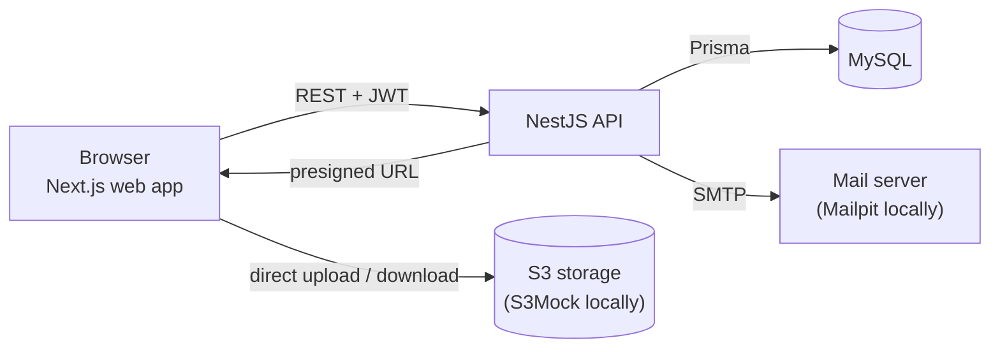

# Architecture

PolyDesign is a three-layer web application. The web app and the API are fully decoupled
and only talk through a REST API authenticated with JWT.

## Layers

| Layer        | Workspace                 | Responsibility                                                      |
| ------------ | ------------------------- | ------------------------------------------------------------------- |
| Presentation | `apps/web`                | Pages, forms, 3D viewer; calls the API with an authenticated client |
| Business     | `apps/api`                | REST resources, validation, authorization (guards), business rules  |
| Data         | `apps/api/prisma` + MySQL | Relational data through the Prisma ORM; files in S3 storage         |

## Uploading 3D files

3D files are large (`.glb`, `.fbx`, `.obj`), so they never go through the API:

1. the creator fills the upload form; the web app asks the API for a **presigned URL**;
2. the API checks the JWT and the creator role, validates the file type and size, and
   returns a short-lived URL;
3. the browser uploads the file **directly** to the S3 storage;
4. the web app sends the model metadata (title, category, license, file key) to the API,
   which saves the model in the database.

This keeps the API light and the storage costs under control.

## API modules (NestJS)

Each feature is a NestJS module (controller + service + DTOs):

- `health` — liveness and database check
- `auth` — sign-up, sign-in, JWT issuing, password hashing with Argon2
- `users` — profile, GDPR rights (access, update, deletion)
- `models` — 3D model CRUD, search and filters, downloads
- `uploads` — presigned URLs for files and images
- `categories`, `licenses` — reference data
- `community` — likes, favorites, comments
- `reports` — reporting a model, moderation
- `admin` — back office (models, accounts, reports)

## Security

- Passwords hashed with **Argon2**; JWT signed with an expiry
- **Role guards** on every sensitive route + **ownership checks** before update/delete (IDOR)
- Every input validated with **Zod**; Prisma parameterized queries (SQL injection)
- CORS restricted to the web app origin, secrets in environment variables
- See the OWASP Top 10 mapping in the project file
