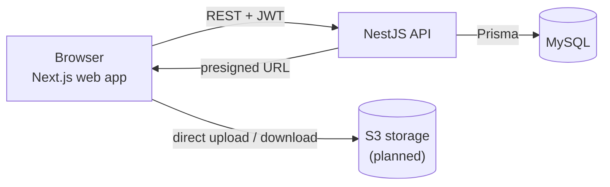

# Architecture

PolyDesign is a three-layer web application. The web app and the API are fully decoupled
and only talk through a REST API authenticated with JWT.

## Layers

| Layer        | Workspace                 | Responsibility                                                      |
| ------------ | ------------------------- | ------------------------------------------------------------------- |
| Presentation | `apps/web`                | Pages, forms, 3D viewer; calls the API with an authenticated client |
| Business     | `apps/api`                | REST resources, validation, authorization (guards), business rules  |
| Data         | `apps/api/prisma` + MySQL | Relational data through the Prisma ORM; files in S3 storage         |

## Uploading 3D files

3D files are large (`.glb`, `.fbx`, `.obj`), so they never go through the API:

1. the creator creates the model (title, description, category, license, technical details); it is saved as a **draft**;
2. for each file, the web app sends its name, format and size to the API, which checks the creator role,
   the ownership of the model, the format and the size, saves the file as **pending** and returns a
   short-lived **presigned upload URL**;
3. the browser uploads the file **directly** to the S3 storage;
4. the web app tells the API the upload is complete; the API checks the object in S3 (it exists, its size
   and type are the expected ones) and marks the file as **uploaded**;
5. the creator publishes the model, which is only possible with at least one uploaded file.

This keeps the API light, the storage costs under control, and no file is ever referenced without being checked.

## API modules (NestJS)

Each feature is a NestJS module (controller + service + DTOs):

- `health`: liveness and database check
- `auth`: sign-up, sign-in, JWT issuing, password hashing with Argon2
- `users`: profile, GDPR rights (access, update, deletion)
- `models`: 3D model CRUD, search and filters, downloads
- `uploads`: presigned URLs for files and images
- `categories`, `licenses`: reference data
- `community`: likes, favorites, comments
- `reports`: reporting a model, moderation
- `admin`: back office (models, accounts, reports)

## Security

- Passwords hashed with **Argon2**; JWT signed with an expiry
- **Role guards** on every sensitive route + **ownership checks** before update/delete (IDOR)
- Every input validated with **Zod**; Prisma parameterized queries (SQL injection)
- CORS restricted to the web app origin, secrets in environment variables
- See the OWASP Top 10 mapping in the project file

## Local services

`docker compose up -d` starts the development environment (see `docker-compose.yml`, commented line by line):

- `mysql`: the database (MySQL 8.4), with its data kept in a Docker volume;
- `adminer`: a web page to look at the tables, on http://localhost:8080;
- `api`: the NestJS API, which reaches the database with the host name `mysql`;
- `web`: the Next.js app, which calls the API through `localhost:4000` because the call is made by the browser.

A fake S3 storage and a fake mail server will be added when the upload and e-mail features need them.
The local database URL has `allowPublicKeyRetrieval=true`, needed to sign in to MySQL without TLS.
In production the connection uses TLS and this option is removed.
