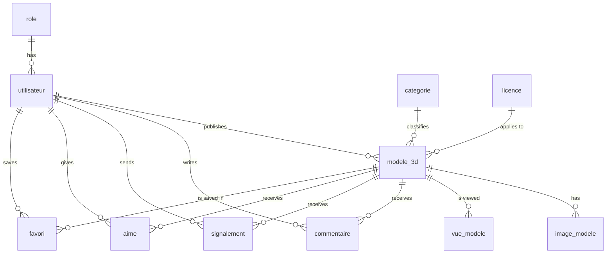

# Data model

The database has **11 tables**. In the code, Prisma models use English names; they are
mapped (`@@map` / `@map`) to the table and column names of the design document.

| Prisma model | Table          | Description                                                  |
| ------------ | -------------- | ------------------------------------------------------------ |
| `Role`       | `role`         | `USER`, `CREATOR`, `ADMIN`                                   |
| `User`       | `utilisateur`  | Account, profile, premium status, GDPR consent date          |
| `Category`   | `categorie`    | Model categories (characters, vehicles, architecture...)     |
| `License`    | `licence`      | Free or paid usage licenses                                  |
| `Model3D`    | `modele_3d`    | A published 3D model: file, price, technical details, status |
| `ModelImage` | `image_modele` | Preview images of a model, ordered by `position`             |
| `ModelView`  | `vue_modele`   | One row per view (used for statistics)                       |
| `Comment`    | `commentaire`  | Comments left on a model                                     |
| `Report`     | `signalement`  | Reports sent to the moderators                               |
| `Like`       | `aime`         | User ↔ model "like" (composite primary key)                  |
| `Favorite`   | `favori`       | User ↔ model favorite (composite primary key)                |

## Relationships

## Integrity rules

- Deleting a user deletes their models, comments, reports, likes and favorites (`ON DELETE CASCADE`).
- A role, category or license still in use cannot be deleted (`ON DELETE RESTRICT`).
- `aime` and `favori` use a composite primary key `(utilisateur_id, modele_id)`: a user
  cannot like or favorite the same model twice.
- Model status: `brouillon` (draft) → `en_revision` (in review) → `publie` (published) → `retire` (removed).

The source of truth is [`apps/api/prisma/schema.prisma`](../apps/api/prisma/schema.prisma).
