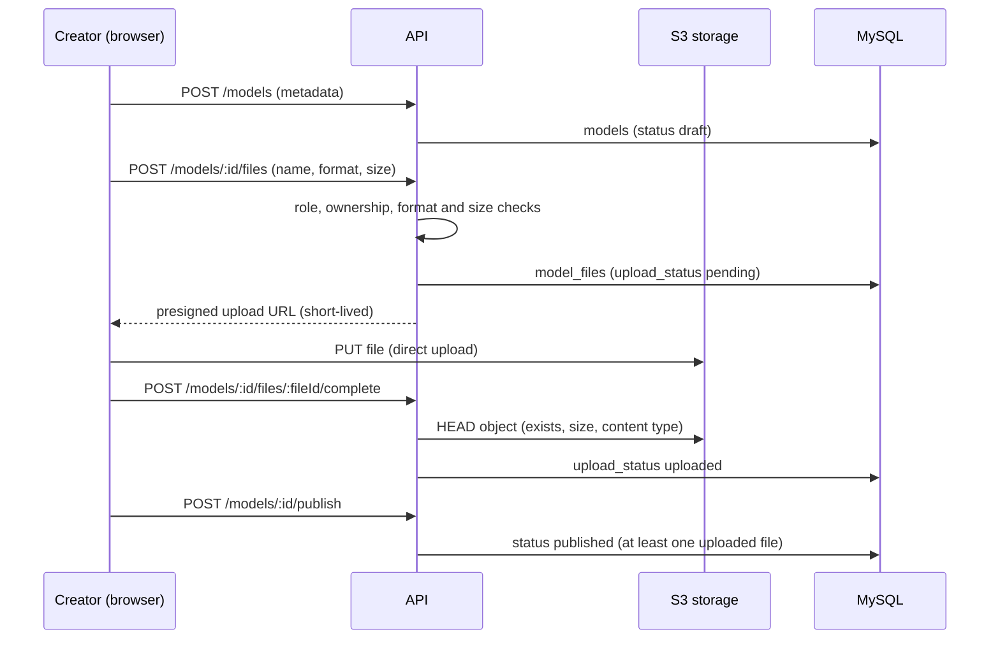

# Data model

The database has **23 tables** (MySQL 8). The source of truth is
[`apps/api/prisma/schema.prisma`](../apps/api/prisma/schema.prisma). The diagram source is
[`data-model.dbml`](data-model.dbml), paste it into [dbdiagram.io](https://dbdiagram.io/d) to view it.

## Tables

| Domain     | Table               | Content                                                                     |
| ---------- | ------------------- | --------------------------------------------------------------------------- |
| Accounts   | `roles`             | `USER`, `CREATOR`, `ADMIN`                                                  |
|            | `users`             | Account, profile, GDPR consent, e-mail verification, lockout, anonymization |
|            | `subscriptions`     | Premium subscription history                                                |
|            | `user_tokens`       | Single-use e-mail links: e-mail verification, password reset                |
|            | `refresh_tokens`    | Sessions (hashed, rotated, revocable)                                       |
|            | `user_links`        | Creator links: website, ArtStation, Sketchfab, Instagram, YouTube, X        |
|            | `follows`           | A user follows a creator                                                    |
| Catalog    | `categories`        | Categories and subcategories (`parent_id`)                                  |
|            | `licenses`          | Usage rights: commercial use, modifications                                 |
|            | `tags`              | Styles: Cyberpunk, Sci-Fi, Low-poly...                                      |
|            | `models`            | Model or pack: metadata, technical details, visibility, status, counters    |
|            | `model_files`       | Files of a model (1 to N), format, size, S3 key, upload status              |
|            | `model_tags`        | Model and tag                                                               |
|            | `model_images`      | Preview images, position 0 is the thumbnail                                 |
| Activity   | `downloads`         | Download history and creator statistics                                     |
|            | `model_views`       | Views, with a hashed IP                                                     |
| Community  | `comments`          | Comments and replies (`parent_id`), can be hidden by a moderator            |
|            | `ratings`           | 1 to 5 stars, one per user and model                                        |
|            | `likes`             | Likes                                                                       |
|            | `favorites`         | Favorites                                                                   |
|            | `collections`       | Personal lists of models                                                    |
|            | `collection_models` | Models of a collection                                                      |
| Moderation | `reports`           | Reports, their status and the admin who handled them                        |

## Technical details of a model

Based on what Sketchfab and CGTrader ask creators:

| Column                                      | Values                                                  |
| ------------------------------------------- | ------------------------------------------------------- |
| `model_type`                                | `cgi`, `print_3d`                                       |
| `visibility`                                | `public`, `unlisted`, `private`                         |
| `is_downloadable`                           | the creator can show a model without allowing downloads |
| `allow_comments`                            | comments enabled or not                                 |
| `is_ai_generated`                           | created with generative AI tools                        |
| `is_age_restricted`                         | age-restricted content                                  |
| `has_textures`, `has_materials`, `is_pbr`   | materials                                               |
| `is_rigged`, `is_animated`, `is_game_ready` | usage                                                   |
| `uv_unwrapping`                             | `yes`, `no`, `overlapping`, `mixed`                     |
| `geometry`                                  | `polygon_mesh`, `subdivision`, `nurbs`, `mixed`         |
| `polygon_count`, `vertex_count`             | counts                                                  |
| `software`, `plugins_used`                  | tools used                                              |

## Main feature: from upload to consultation

Visitors then browse `GET /models` (published and public models only), open `GET /models/:slug`
(a view is recorded with a hashed IP), and signed-in users download through a short-lived presigned
URL (a row is added to `downloads`, premium models require an active subscription).

## Security and integrity

- **Passwords**: Argon2id hash only (`password_hash`).
- **Tokens** (e-mail links, refresh tokens): only their SHA-256 hash is stored. They expire and are
  single-use (`used_at`) or revocable (`revoked_at`).
- **Brute force**: `failed_login_attempts` and `locked_until`.
- **Files**: the format is an enum, so the whitelist is enforced by MySQL. Files are referenced by their
  S3 key, never by a public URL. A file is only used once the API has checked it in S3
  (`upload_status = uploaded`). Optional SHA-256 checksum.
- **GDPR**: consent date, hashed IP for views, account anonymization (`deleted_at`) instead of deletion,
  so replies and ratings of other users stay consistent.
- **Referential integrity**:
  - users are never deleted, their content uses `ON DELETE RESTRICT`;
  - 3D models are removed with a status (`removed`), downloads are kept;
  - files, images, tags, comments of a model use `ON DELETE CASCADE`;
  - roles, categories and licenses in use cannot be deleted (`RESTRICT`).
- **CHECK constraints** (migration `add_check_constraints`): rating score between 1 and 5, file size
  greater than 0, a published model has a publication date, a subscription ends after it starts.
- **No duplicates**: composite primary keys on likes, favorites, ratings, follows, model tags and
  collection models; unique slug, e-mail, username and storage keys.
